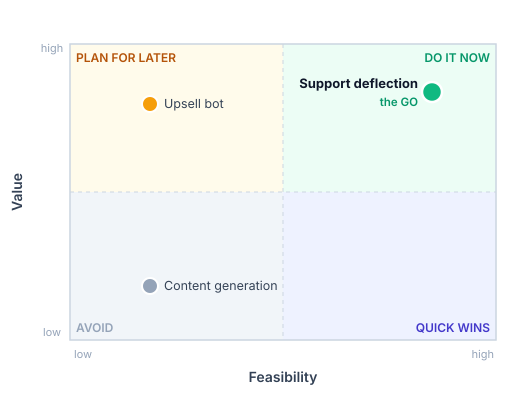
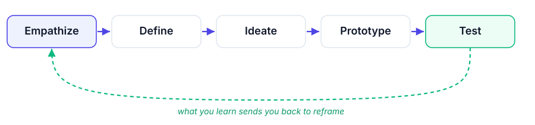

<!-- _class: lead -->
<!-- _paginate: false -->

AI for FDE &middot; Module 1 &middot; Session 1

# Framing the Engagement

### A working session, not a lecture. Today you are the Forward Deployed Engineer on the Sunrise Electronics account. A wish list just landed. You will drive it, all the way to a committed, defensible decision to build.

We work the real moves first. At the end, we name what you learned.

---

## The brief just landed

from: Vikram Rao, VP Customer Experience, Sunrise Electronics

"The board wants us to use AI on customer experience this year, and everyone here has an opinion. Let me dump it all:
<ul>
<li>My support team is drowning in the same questions all day (order status, returns, warranty), and the hard cases wait behind them.</li>
<li>Sales heard about this and wants the same assistant to upsell and cross-sell while it talks to customers.</li>
<li>Marketing (and the CEO, who saw a demo) want it on brand, and to generate our help content and campaigns too.</li>
<li>Our CSAT slipped last quarter and I am being asked to fix it, so whatever we build has to make customers happier.</li>
<li>IT says we have years of data so this should be easy, and it obviously has to work with our systems and be secure.</li>
<li>Budget is tight and I need something to show the board by end of quarter."</li>
</ul>

<b>One direction, six agendas</b> This is not six projects. It is one initiative ("AI for customer experience") with every team bolting on its own priority, and nobody has done the value analysis. Vikram is senior, board-facing, and impatient. Untangling this is your job.

---

## Your homework starts now

the FDE's real first job

This is not homework you assign the customer, and not a task anyone hands you. The moment a wish list like this lands, an FDE has homework to do, before a line of code.

<h3>What just landed on you</h3>
One vague direction with six teams' priorities bolted on, no owner, no value analysis, and a deadline. Take it at face value and you will try to build all of it, and land none of it.

<h3>The homework, before building</h3>
Read past the asks to the needs, separate the stakeholders and their agendas, weigh each on value, and reduce the noise to one problem you can defend. That homework is <strong>triage, frame, discover, qualify</strong>, and it is this whole session.

<b>Nobody will ask you to do this</b> The customer will not request it and it will not appear on a ticket. Doing it anyway, before you build, is exactly what separates an FDE from an order-taker.

---

## Where we are going: the Frame framework

Your homework is one framework, run in four moves. Each move is a small body of knowledge with its own inputs, process, tools, and outputs. We open each move with that map, then run it live. The output of one move is the input to the next.

Wish list&rarr;
Triage&rarr;
Frame&rarr;
Discover&rarr;
Qualify&rarr;
Committed GO

<h3>What each move gives you</h3>
A named <strong>input</strong>, a <strong>process</strong> to run, the <strong>tools</strong> that fit, and a concrete <strong>output</strong> you can hand on. That is the body-of-knowledge shape, the one PMBOK uses.

<h3>How we teach each one</h3>
Open with the map (what this move is, and its inputs, process, tools, outputs), run it live on Sunrise, then read the result back through the same four boxes.

<b>The rule for today</b> We do not start with pure theory. You name the shape of a move, then run it live, make the calls an FDE makes, and produce the real artifacts. Starting with Triage.

---

## Move 1 &middot; Triage: what it is

Triage is the systematic process of prioritizing incoming items by urgency, severity, and the resources you have. It began in military medicine in World War I: treat the high-impact cases now, and defer, delegate, or drop the rest.

the three-bucket model

<h3>Critical / urgent</h3>
Immediate action. Needs resources now.

<h3>Non-critical</h3>
Deferred or queued. Low risk in waiting.

<h3>Unserviceable</h3>
Rejected or dropped. Not worth the resources.

<b>Route, do not resolve</b> Triage sorts every incoming demand into one of these three. It decides what gets attention, not how to fix it.

---

## The same move, in every field

You already know triage. It runs the emergency room, the incident bridge, and the product backlog.

| Domain | What is triaged | Objective | Example |
| --- | --- | --- | --- |
| **Emergency medicine** | patients arriving at the ED | stabilize the critical first | trauma treated now; a minor fracture waits |
| **Incident response (SRE)** | alerts, outages, bugs | contain blast radius, cut downtime | fix a DB pool crash before a UI alignment bug |
| **Product and support** | tickets, bugs, requests | throughput and stability | P0 auth down; P2 missing export icon |
| **Project management** | tasks, emails, backlog | protect focus, hit deadlines | Eisenhower: urgent vs important |

<b>Different stakes, one discipline</b> The domain changes; the move does not. As an FDE you are running the product-and-support row, on an AI wish list.

---

## Principles of effective triage

<h3>Speed and decisiveness</h3>
Assess quickly and route. The goal is to place the problem, not to solve it on the spot.

<h3>Dynamic re-evaluation</h3>
Priorities shift. A low-urgency item turns critical when context changes, so you revisit.

<h3>Resource awareness</h3>
Priority depends on constraints: the engineers, doctors, or compute and budget you actually have.

<b>Why it fits the FDE</b> A vague, over-wished brief on a tight budget is exactly a triage problem: many demands, real constraints, one quarter.

---

## Triage as a body of knowledge (ITTO)

Now the shape of the move, in the abstract. Every stage today has these four boxes, the ones PMBOK uses: inputs, a process, the tools you apply, and the outputs it produces.

| Inputs | Process | Tools and techniques | Outputs |
| --- | --- | --- | --- |
| Incoming demands (requests, tickets, asks) with their urgency and severity signals, plus the resources and constraints you have | Assess each item fast; score it; sort into critical, non-critical, unserviceable; re-evaluate as context shifts | Pareto (80/20), weighted scoring (RICE or ICE), MoSCoW, the Eisenhower matrix | A ranked, scored priority list: the critical few to act on now, and an explicit deferred or dropped set |

<b>Read it left to right</b> Inputs come in, the process acts on them with the tools, and the outputs come out. First, meet the tools in that box.

---

## Tool 1 &middot; Pareto: the vital few

The Pareto principle, the 80/20 rule: roughly 80 percent of the effect comes from 20 percent of the causes. In prioritization, a small share of items carries most of the impact.

<h3>The idea</h3>
Rank items by volume or impact. A short head accounts for most of the total; a long tail accounts for little. Spend your resources on the head.

<h3>What it is good for</h3>
Cutting through a long list fast. It answers one question: where is the concentration, and so where should attention go first.

<b>Everyday Pareto</b> A fifth of customers drive most of the revenue; a fifth of bugs cause most of the crashes. Find that fifth before you do anything else.

---

## Pareto on Sunrise's tickets

Break the 4,000 weekly tickets down by question type, highest volume first.

| Question type | Share of tickets | In the vital few? |
| --- | --- | --- |
| Where is my order | about 30 percent | yes |
| How do I return this | about 18 percent | yes |
| Is it under warranty (simple) | about 12 percent | yes |
| Everything else (long tail) | about 40 percent | no, many rare types |

<b>What Pareto solves here</b> Three question types are about 60 percent of all tickets. Deflect those and you move most of the volume. It also tells you not to chase the long tail of rare questions, where the effort is high and the payoff small.

---

## Tool 2 &middot; RICE and ICE: score, do not argue

A weighted scoring model that turns opinions into comparable numbers, so the ranking is defensible in a room of competing priorities.

<h3>RICE</h3>
Score = (<strong>Reach</strong> times <strong>Impact</strong> times <strong>Confidence</strong>) divided by <strong>Effort</strong>. Reach: how many are affected. Impact: how much. Confidence: how sure you are. Effort: what it costs to build.

<h3>ICE</h3>
The lighter version: <strong>Impact</strong> times <strong>Confidence</strong> times <strong>Ease</strong>. Faster to run when you have less data, and good enough for a first cut.

<b>Why score</b> A number you can show beats "I feel this is important." It makes the ranking survive the stakeholders who each brought a different priority.

---

## RICE on Sunrise's asks

Score the candidate asks on a 1 to 5 scale. Higher is better, except Effort, which divides.

| Ask | Reach | Impact | Confidence | Effort | Score |
| --- | --- | --- | --- | --- | --- |
| **Support deflection** | 5 | 4 | 4 | 2 | **40** |
| Upsell bot | 4 | 3 | 2 | 4 | 6 |
| Marketing content | 3 | 2 | 2 | 3 | 4 |

<b>What RICE solves here</b> Support deflection scores an order of magnitude higher: wide reach, real impact, high confidence (the answers already exist), and low effort. The numbers separate the one worth building from the wishes, on evidence Vikram can read.

---

## Tool 3 &middot; MoSCoW: draw the line on scope

Sort every item into four buckets, agreed with the stakeholders, so scope is explicit and expectations are set.

<h3>Must and Should</h3>
<strong>Must have:</strong> the release fails without it. <strong>Should have:</strong> important, but the release survives a short delay.

<h3>Could and Won't</h3>
<strong>Could have:</strong> nice if time allows. <strong>Won't have this time:</strong> explicitly out of scope, and named, so it does not creep back in.

<b>The power is in the Won't</b> Saying out loud what you will not do this quarter is how you protect the scope from six stakeholders each pushing their own item.

---

## MoSCoW on Sunrise's scope

<h3>Must have</h3>
Deflect order, return, and simple-warranty questions with grounded answers.

<h3>Should have</h3>
Clean escalation to a human for anything out of scope or uncertain.

<h3>Could have</h3>
Track CSAT on deflected chats; add more question types later.

<h3>Won't have this quarter</h3>
Upsell in the bot, and generated help content or campaigns.

<b>What MoSCoW solves here</b> It turns the six competing asks into an agreed scope. Sales, Marketing, and the CEO see their items in Could or Won't, with a reason, not a flat rejection, and Vikram gets a shippable quarter.

---

## The call: one problem, defended

You did not run the tools to please every team. You ran them to make one pick you can defend, and all three converge on the same answer.

<h3>The pick</h3>
Support deflection: order, return, and simple-warranty questions. Pareto put the volume here, RICE scored it far above the rest, and MoSCoW made it the Must.

<h3>Deferred, with reasons</h3>
Upsell and generated marketing content go to Could or Won't this quarter, and CSAT becomes a metric, not a project. Nothing is rejected; it is sequenced, so each stakeholder sees why.

<b>Then the feasibility gate</b> Is it even an AI problem, is the data there, and what is the risk? Yes: the answers live in documents, the help center and past tickets exist, and a wrong "where is my order" is low harm. It passes.

---

## Triage on Sunrise, walked through ITTO

The same four boxes, now filled with the real engagement. This is what you just produced, read back through the framework.

| Inputs | Process | Tools and techniques | Outputs |
| --- | --- | --- | --- |
| Vikram's six competing asks; about 4,000 tickets a week, roughly 60 percent repetitive; a tight budget and a quarter-end deadline | Scored the asks with Pareto, RICE, and MoSCoW; sorted into pick, defer, drop; ran the feasibility gate on the survivor | Pareto (the repetitive 60 percent are the vital few), RICE scoring, MoSCoW across the six asks | A scored list with one clear winner: support deflection is the problem worth the quarter; the rest deferred or dropped, with reasons |

<b>Output becomes the next input</b> Triage's output, one chosen problem, is the input to Frame. That is how the four moves chain into one framework.

---

## Why we triage

Because you cannot build six stakeholders' priorities at once, and building the wrong thing well is still a failure.

<h3>What triage buys you</h3>
One problem worth solving, chosen on evidence, separated from the politics piled onto it, that you can defend to a VP asking hard questions.

<h3>Skip it, and</h3>
You try to satisfy every team at once, spread thin, burn the quarter and the budget, and the customer's real problem is still there.

<b>The point</b> Focus is the FDE's first act of value. Choosing well, early, is worth more than building fast.

---

## Vikram pushes: "Great, so build the support bot"

You have a chosen problem. You do not yet have a solution shape. "A support bot" is a tool, picked before anyone decided what it should do. Nodding here is the classic mistake.

<h3>Jump to the tool</h3>
Build a chatbot because that is the word everyone used. It fits the tool, not the customer, and it will demo but not land.

<h3>Hold, and frame</h3>
Push back gently: "before we build, let me make sure we solve the right thing." Then frame the problem and put real options on the table.

<b>Move 2 &middot; Frame</b> Before you accept a tool, you frame the problem: understand it, find the root, write it tool-free, and put real options on the table. Here is what framing is, and the tools that do it.

---

## Move 2 &middot; Frame: what it is

Framing turns a vague ask into a sharp, tool-free problem statement and a set of genuinely different options. It is the define-and-ideate heart of design thinking: understand the user, state the problem, generate options.

<h3>Problem, not solution</h3>
A frame names the outcome to reach and the person it is for. It never names a tool. "Build a chatbot" is a solution wearing a problem's clothes.

<h3>Options, not one idea</h3>
Good framing ends with two or three distinct ways to solve the problem, so the later choice is real, not a rubber stamp on the first idea.

<b>The move in one line</b> Understand, define the problem, then diverge into options. You leave with a statement and a short menu, not a build order.

---

## The same trap, in every field

Jumping to a solution before framing the problem is universal. Naming the trap is why framing exists.

| Field | The solution-first trap | The framed question |
| --- | --- | --- |
| **Medicine** | treat the symptom that presents | what is the underlying condition |
| **Engineering** | build the feature that was requested | what job is the user trying to do |
| **Consulting** | answer the question as asked | what decision does the client actually face |
| **AI projects** | build the bot everyone named | what problem must it solve, and how else could we |

<b>Why FDEs get trapped</b> AI makes it trivial to build the named thing fast. Speed to the wrong build is the modern version of the oldest mistake.

---

## Principles of effective framing

<h3>Problem from solution</h3>
State the outcome and the user. If a tool name appears, you are solutioning, not framing.

<h3>Ground it in observation</h3>
Frame from what you saw, not what was reported. Watch the work before you word the problem.

<h3>Diverge, then converge</h3>
Generate distinct options first. Narrowing too early hides the option that would have won.

<b>The test of a good frame</b> The stakeholder reads it and says "yes, exactly," and it contains no tool. If it names a tool, reframe.

---

## Frame as a body of knowledge (ITTO)

The same four boxes as before, now for framing.

| Inputs | Process | Tools and techniques | Outputs |
| --- | --- | --- | --- |
| The one problem from triage; observation of the real work; the customer's words and stated ask | Understand the user and the job; find the root cause; write one sharp, tool-free problem statement; diverge into options | Jobs-to-be-Done, How Might We, 5 Whys | A problem statement the stakeholder agrees with, and two or three genuinely different options |

<b>Read it left to right</b> The chosen problem comes in; understanding, root cause, and divergence act on it; a framed statement with real options comes out. First, the tools.

---

## Tool 1 &middot; Jobs-to-be-Done

People do not want a product; they hire it to get a job done. Frame the job, not the feature, and the real problem appears.

<h3>The shape</h3>
"When <em>[situation]</em>, I want to <em>[motivation]</em>, so I can <em>[outcome]</em>." The job stays stable even when the tools change.

<h3>What it is good for</h3>
Stripping a request down to the outcome the user is really after, so you do not build features nobody hired.

<b>Classic line</b> People do not want a quarter-inch drill; they want a quarter-inch hole. Find the hole.

---

## Jobs-to-be-Done on Sunrise

Write the jobs behind the support ask, for both the customer and the agent.

<h3>The customer's job</h3>
"When I have a question about my order, return, or warranty, I want a correct answer immediately, so I can stop worrying and not wait in a queue."

<h3>The agent's job</h3>
"When routine questions flood in, I want them handled without me, so I can spend my time on the cases that actually need a person."

<b>What JTBD solves here</b> Neither job is "a chatbot." Both are "an instant, correct answer to a common question." That reframes "build a support bot" into a problem about self-serve answers, which opens real options.

---

## Tool 2 &middot; How Might We

Turn the problem into an open question that invites solutions, pitched at the right altitude: not so broad it is useless, not so narrow it hides a single answer.

<h3>The shape</h3>
"How might we <em>[achieve the outcome]</em> for <em>[the user]</em>?" Optimistic, open, and free of any named tool.

<h3>Altitude matters</h3>
Too broad ("how might we fix support") gives nothing. Too narrow ("how might we add a chatbot") smuggles in the answer. Aim in between.

<b>Why it works</b> A good "how might we" makes people generate options instead of defending one. It is the doorway from problem to ideas.

---

## How Might We on Sunrise

Phrase the framed job as an invitation, then watch the options fall out.

the framed question

"How might we give Sunrise's customers an instant, correct answer to their most common questions, without tying up an agent?"

<b>What How Might We solves here</b> That one question invites three distinct answers: <strong>deflect</strong> (self-serve answers), <strong>route</strong> (send the ticket to the right queue), and <strong>assist</strong> (draft a reply the agent sends). The problem now has a real menu, not a foregone bot.

---

## Tool 3 &middot; 5 Whys

Ask "why" repeatedly, each answer feeding the next question, until you pass the symptom and reach a cause you can actually act on.

<h3>The shape</h3>
Start from the stated problem and ask why about five times. The number is a guide, not a rule; stop when you hit a root you can change.

<h3>What it is good for</h3>
Making sure you frame the cause, not the symptom, so the solution addresses what actually generates the pain.

<b>Watch for the wall</b> When "why" stops giving a changeable answer and starts giving "that is just how it is," you have found the root worth framing.

---

## 5 Whys on Sunrise

Start from Vikram's words and dig.

<ul>
<li><strong>Support is drowning.</strong> Why? Agents answer the same questions all day.</li>
<li>Why do those reach an agent? There is no way for a customer to self-serve the answer.</li>
<li>Why can they not self-serve? The answers exist, but only inside help pages and past tickets no one searches well.</li>
<li>Why is that not enough? The content is not written as answers to real questions, and it is not instant.</li>
<li><strong>Root:</strong> customers cannot get an instant, correct answer to a common question from content Sunrise already owns.</li>
</ul>

<b>What 5 Whys solves here</b> The problem is not "too few agents" or "no chatbot." It is unreachable answers, and that root is exactly what a deflection option addresses. It confirms the frame.

---

## The call: a sharp problem and three options

The tools converge on one statement and a real menu. This is what you hand forward.

the problem statement

"Support agents spend most of their day answering the same order, return, and warranty questions, which delays the complex cases that need a person. How might we give customers instant, correct answers to those questions from Sunrise's own content?"

<h3>Deflect</h3>
Self-serve answerer: grounded answers, no ticket opened. <em>high value, data looks ready</em>

<h3>Route</h3>
Classifier: tickets sorted to the right queue. <em>medium value, tickets to learn from</em>

<h3>Assist</h3>
Agent copilot: drafts a reply a human approves. <em>medium value, needs adoption</em>

<b>These reads are still guesses</b> The value and readiness notes are first impressions, not facts. You cannot commit on guesses, which is exactly why Discover comes next.

---

## Frame on Sunrise, walked through ITTO

The four boxes, filled with what you just produced.

| Inputs | Process | Tools and techniques | Outputs |
| --- | --- | --- | --- |
| The chosen problem (support deflection); an hour watching agents; Vikram's "build a support bot" | Wrote the customer and agent jobs; asked why to the root; phrased a how-might-we; diverged into options | Jobs-to-be-Done, How Might We, 5 Whys | A tool-free problem statement Vikram agrees with, and three distinct options: deflect, route, assist |

<b>Output becomes the next input</b> The framed problem and its options are the input to Discover, where you replace the guesses with facts.

---

## Why we frame

Because "build a chatbot" is a tool, and if you accept the customer's tool you solve their guess, not their problem.

<h3>What framing buys you</h3>
A sharp problem and several real options, so the solution is a choice you can reason about, not the first word someone said.

<h3>Skip it, and</h3>
You build the first idea, it demos well, and it does not land, because it fit the tool instead of the customer.

<b>The point</b> The tool must serve the problem. Framing is how you keep it that way, especially when AI makes it easy to build the wrong thing quickly.

---

## Move 3 &middot; Discover: what it is

Discovery grounds the framed options in what is actually true, before you commit. You separate the stated ask from the real need, and map the stakeholders, data, systems, and constraints the solution will live inside.

<h3>Ask is not need</h3>
The customer's words are a starting point, not the truth. You go and look: real tickets, real systems, real people, real limits.

<h3>Surface what would ambush you</h3>
The veto you did not know about, the data messier than promised, the constraint nobody mentioned. Find them now, while you can still act.

<b>The move in one line</b> Replace the assumptions inside your options with facts, so the decision that follows rests on the ground, not on hope.

---

## The same move, in every field

Before a good decision, someone does the unglamorous work of finding out what is real.

| Field | The discovery work | What it prevents |
| --- | --- | --- |
| **Medicine** | history, examination, tests | treating the wrong condition |
| **Journalism** | sourcing and verification | printing a false story |
| **Audit** | tracing records to evidence | signing off on a fiction |
| **Software** | requirements and user research | building the wrong system |

<b>The FDE version</b> A week of listening before a quarter of building. The cost of discovery is always smaller than the cost of the wrong build.

---

## Principles of effective discovery

<h3>Go and see</h3>
Observe the real work and the real data. Reported reality and actual reality are never quite the same.

<h3>Follow the constraints</h3>
Legal, residency, budget, and timeline shape what is buildable. A constraint found late is a project killed late.

<h3>Find every veto</h3>
Anyone who can say no is a stakeholder. Meet them before you commit, not after.

<b>The discipline</b> Discovery is listening with a purpose: not "tell me everything," but "what would make this fail, and who could stop it."

---

## Discover as a body of knowledge (ITTO)

The four boxes, now for discovery.

| Inputs | Process | Tools and techniques | Outputs |
| --- | --- | --- | --- |
| The framed problem and its options; access to people, tickets, systems, and documents | Separate ask from need; interview stakeholders; trace where data and answers live; map the journey; list constraints and vetoes | Power-Interest grid, RACI, customer-journey map | A discovery brief: the real need, the data and its state, the systems, the constraints, the stakeholders, and a narrowed scope |

<b>Read it left to right</b> Framed options come in; observation and mapping act on them; a grounded brief comes out. First, the tools.

---

## Tool 1 &middot; Power-Interest grid

Also called Mendelow's matrix. Plot every stakeholder on two axes: how much power they have over the project, and how much interest they have in it.

<h3>The four quadrants</h3>
<strong>High power, high interest:</strong> manage closely. <strong>High power, low interest:</strong> keep satisfied. <strong>Low power, high interest:</strong> keep informed. <strong>Low power, low interest:</strong> monitor.

<h3>What it is good for</h3>
Spending your attention where it changes the outcome, and never being surprised by who can block you.

<b>Why power and interest</b> A quiet stakeholder with a veto will sink you faster than a loud one with none. The grid tells them apart.

---

## Power-Interest on Sunrise

Place the people the deflection project touches.

| Stakeholder | Power | Interest | How to handle |
| --- | --- | --- | --- |
| **Vikram (VP CX)** | high | high | manage closely: your sponsor and your skeptic |
| **Legal** | high (can veto warranty answers) | medium | keep satisfied: get scope signed early |
| **IT** | high (owns data and systems) | medium | keep satisfied: agree access and integration |
| **Support agents** | low (formal) | high (adoption) | keep informed and involve: they make or break it |

<b>What the grid solves here</b> It surfaces Legal as a high-power, easy-to-miss veto on warranty answers, and flags that agents, with no formal power, decide adoption. Both change the scope and the plan.

---

## Tool 2 &middot; RACI

A simple grid that assigns four roles to each task or decision: who is Responsible (does the work), Accountable (owns the outcome, exactly one), Consulted (gives input), and Informed (kept in the loop).

<h3>The rule</h3>
Every task has exactly one <strong>Accountable</strong>. More than one, and no one owns it; none, and it falls through the cracks.

<h3>What it is good for</h3>
Killing the "I thought you had it" failures before they happen, and making handoffs explicit across teams.

<b>Why it matters for an FDE</b> You work across the customer's org. RACI is how you make sure a decision has an owner, not an audience.

---

## RACI on Sunrise

Assign roles for the deflection PoC, so nothing waits on "someone."

| Task | Responsible | Accountable | Consulted | Informed |
| --- | --- | --- | --- | --- |
| Approve warranty answer scope | Legal | Vikram | Support ops | CEO |
| Provide help content and tickets | IT | Vikram | Support ops | you |
| Build the deflection PoC | you (FDE) | Vikram | IT, agents | Legal |
| Sign off on go-live | Vikram | Vikram | Legal, IT | board |

<b>What RACI solves here</b> It names Vikram as the single accountable owner, gets Legal consulted (not surprised) on scope, and turns the content handoff from IT into an explicit task with a date, not a hope.

---

## Tool 3 &middot; Customer-journey map

Lay out the steps a customer actually takes, end to end, with what they do, what they feel, and where it breaks. It shows exactly where a solution should sit.

<h3>The shape</h3>
Stages across the top; for each, the customer's action, their goal, and the pain point. The worst pains are your opportunities.

<h3>What it is good for</h3>
Placing the fix where the pain is, and seeing the moments a wrong answer would do real harm.

<b>Why map the journey</b> A solution that ignores the surrounding steps solves a slide, not a customer. The map keeps you honest about context.

---

## Journey map on Sunrise

Trace a customer with a "where is my order" question.

| Stage | What the customer does | Pain today |
| --- | --- | --- |
| **Question arises** | checks email, then the website | no obvious self-serve answer |
| **Looks for help** | scans help pages, gives up | content is not written as answers |
| **Contacts support** | opens a ticket or waits on chat | queue behind the same common questions |
| **Waits** | checks back for a reply | slow, and the answer was simple |

<b>What the map solves here</b> The break is at "looks for help": the answer exists but is unreachable. That is exactly where deflection sits, and it confirms the frame from the customer's side.

---

## The call: the discovery brief

The tools converge into one artifact: what is real, what is scoped, and what would still block you.

discovery brief &middot; Sunrise support deflection

<strong>Real need:</strong> customers cannot get an instant, correct answer to common questions from content Sunrise already owns. 
<strong>Data:</strong> help center and resolved tickets are usable; tribal knowledge in agents' heads is a gap. 
<strong>Stakeholders:</strong> Vikram (sponsor), Legal (warranty veto), IT (data and systems), agents (adoption). 
<strong>Constraints:</strong> customer data stays in Bharat; Legal limits warranty answers to simple cases; quarter-end demo. 
<strong>Scope:</strong> order, return, and simple-warranty questions, grounded in Sunrise content, with escalation to a human.

<b>The guesses are now facts</b> The option reads from Frame are grounded, and the scope is narrowed to what is real and permitted.

---

## Discover on Sunrise, walked through ITTO

The four boxes, filled with what you just produced.

| Inputs | Process | Tools and techniques | Outputs |
| --- | --- | --- | --- |
| The framed problem and three options; access to tickets, content, systems, and people | Separated ask from need; placed stakeholders; assigned roles; mapped the journey; listed constraints | Power-Interest grid, RACI, customer-journey map | A discovery brief: real need, data state, stakeholders and vetoes, constraints, and a narrowed scope |

<b>Output becomes the next input</b> The discovery brief is the input to Qualify, where you turn a grounded picture into a defensible go or no-go.

---

## Why we discover

Because the ask is not the need, and the assumptions hiding in your options are exactly where projects die in month two.

<h3>What discovery buys you</h3>
Facts instead of guesses, and the constraints and stakeholders that would otherwise ambush you late, surfaced while you can still act on them.

<h3>Skip it, and</h3>
You commit on assumptions, then get vetoed by a stakeholder you never met, or blocked by a constraint you never checked.

<b>The point</b> An FDE builds trust by knowing the customer's reality better than the customer wrote it down. Discovery is where that happens.

---

## Move 4 &middot; Qualify: what it is

Qualification turns a grounded picture into a decision you can defend. You score the candidate honestly, place it against the alternatives, and write a go or no-go with the exact conditions that would flip it. You try to kill your own idea before the customer's reality does.

<h3>Decide, do not drift</h3>
An enthusiastic "let us start" is not a decision. A qualified go names the evidence, the assumptions, and the risks out loud.

<h3>Be willing to say no</h3>
The point of qualifying is that some things fail the test. A no you can defend is worth as much as a yes.

<b>The move in one line</b> Convert a grounded brief into a defensible go or no-go, in the language a board funds in.

---

## The same move, in every field

Every field has a gate before the big commitment, where a case is made and a decision is owned.

| Field | The qualification | The decision |
| --- | --- | --- |
| **Investing** | due diligence | fund or pass |
| **Medicine** | risk and benefit assessment | operate or not |
| **Lending** | credit underwriting | approve or decline |
| **AI projects** | feasibility, value, and risk | go or no-go |

<b>The FDE version</b> You are the underwriter of your own project. The memo you write is what a skeptical board reads instead of trusting your enthusiasm.

---

## Principles of effective qualification

<h3>Try to kill it</h3>
Argue the no case as hard as the yes. A go that survives your own attack is one that survives the board.

<h3>Numbers, not adjectives</h3>
"High value" is an opinion. A payback in months is a fact. Qualify in the units the business runs on.

<h3>Name the no-conditions</h3>
State exactly what would flip you to no. Naming them is what makes the yes credible.

<b>The discipline</b> Qualification is honesty under pressure: the pressure to just start building is highest right when you most need to check.

---

## Qualify as a body of knowledge (ITTO)

The four boxes, now for the decision.

| Inputs | Process | Tools and techniques | Outputs |
| --- | --- | --- | --- |
| The discovery brief; the three options; the constraints and the deadline | Test desirability, viability, feasibility; build the business case; trace the value; place it against alternatives; name the no-conditions | DVF, business case (ROI, payback, TCO), value-driver tree, feasibility-by-value grid | A qualification memo: a go or no-go, with evidence, assumptions, and the conditions that would flip it |

<b>Read it left to right</b> A grounded brief comes in; the decision tools act on it; a defensible memo comes out. First, the tools.

---

## Tool 1 &middot; DVF: desirability, viability, feasibility

A decision passes only if it clears three lenses at once. Miss any one and it is not a go.

<h3>Desirability</h3>
Do the users actually want it, and will they adopt it? The field hat.

<h3>Viability</h3>
Does it make business sense: enough value, acceptable cost? The product hat.

<h3>Feasibility</h3>
Can we build it, with the data and risk we have, in the time we have? The engineering hat.

<b>DVF is your three hats</b> The FDE mindset from the start of the session, written as a decision lens. All three green, or it is not a go.

---

## DVF on Sunrise

Run support deflection through all three lenses.

<h3>Desirability</h3>
Customers want instant answers; agents want the routine load gone. Both jobs are real. <strong>Green.</strong>

<h3>Viability</h3>
Half of 4,000 weekly tickets are deflectable; the saving is real against a modest build. <strong>Green.</strong>

<h3>Feasibility</h3>
Standard grounding shape, content exists, low harm with escalation; tribal knowledge is a gap. <strong>Green, with one amber.</strong>

<b>What DVF solves here</b> It forces you to check adoption and business sense, not just "can we build it." Deflection clears all three, which upsell (weak desirability and viability) never did.

---

## Tool 2 &middot; The business case: ROI, payback, TCO

The language a board funds in. Turn the value into money and time, not adjectives.

<h3>The four numbers</h3>
<strong>ROI:</strong> return over cost. <strong>Payback:</strong> how long until it pays for itself. <strong>TCO:</strong> total cost to build and run. <strong>NPV:</strong> value over time, discounted.

<h3>What it is good for</h3>
Converting "this feels valuable" into a number a CFO can check, so the yes survives budget scrutiny.

<b>Why a case, not a claim</b> Enthusiasm does not get funded twice. A defensible payback does.

---

## The business case on Sunrise

Rough numbers, honestly labelled, are enough to defend a first PoC.

| Line | Estimate |
| --- | --- |
| Repetitive tickets a week | about 2,400 (60 percent of 4,000) |
| Conservatively deflected | about 1,200 a week |
| Cost per contact saved | roughly Rs 120 |
| **Run-rate saving** | **about Rs 75 lakh a year** |
| Build and first-year run (TCO) | roughly Rs 25 lakh |
| **Payback** | **under four months** |

<b>What the business case solves here</b> It replaces "support is expensive" with a payback under four months on a conservative deflection rate. That is a number Vikram can take to the board without flinching.

---

## Tool 3 &middot; Value-driver tree

A tree that connects what you build to the number the business cares about, one link at a time, so the value is traceable.

<h3>The shape</h3>
The financial outcome at the root; the operational metrics that drive it as branches; your solution at a leaf. Each link is a claim you can check.

<h3>What it is good for</h3>
Proving the line from "a deflection bot" to "money saved," so no one can wave away the value or inflate it.

<b>Why a tree</b> It makes the value auditable. If a link is weak, you see exactly where the case breaks.

---

## Value-driver tree on Sunrise

Trace the line from the bot to the board's number.

Deflection bot&rarr;
Tickets deflected&rarr;
Agent hours freed&rarr;
Cost to serve down&rarr;
Support margin up

<h3>The driving metric</h3>
Deflection rate is the lever. Every point of deflection is fewer tickets, freed hours, and lower cost to serve.

<h3>The check</h3>
Each arrow is measurable: deflection rate from the bot, hours from staffing, cost from finance. The value is auditable end to end.

<b>What the tree solves here</b> It ties "grounded answers to common questions" all the way to "support margin up," so the value survives a CFO who asks how, exactly.

---

## Place it on the grid, then decide

Score the candidate on the gates, then place it against the alternatives. The go is relative, and it has to hold up.

<h3>The gates, with numbers</h3><ul><li><strong>Feasibility:</strong> standard grounding shape, buildable by quarter-end. Green.</li><li><strong>Data readiness:</strong> content and tickets usable; tribal knowledge a gap. Amber.</li><li><strong>ROI:</strong> half of 4,000 weekly tickets deflectable. Green.</li><li><strong>Risk:</strong> bounded, low-harm, with escalation. Green with guardrails.</li></ul>

<h3>Against the alternatives</h3>

---

## The decision you hand to the board

the artifact

qualification memo &middot; Sunrise support deflection

<strong>Decision: GO</strong>, scoped to order, return, and simple-warranty questions, answered from Sunrise's own help content, with escalation to a human.  
<strong>Evidence:</strong> 60 percent of 4,000 weekly tickets are in scope; content exists; payback under four months; DVF green. 
<strong>Assumptions:</strong> the help content is usable; Legal permits simple-warranty answers. 
<strong>We would say NO if:</strong> the content proved unusable, or Legal forbade warranty answers.

<b>Why the no-conditions matter</b> Naming exactly what would flip you to no is what makes the yes credible to a skeptical VP.

---

## Qualify on Sunrise, walked through ITTO

The four boxes, filled with what you just produced.

| Inputs | Process | Tools and techniques | Outputs |
| --- | --- | --- | --- |
| The discovery brief; the three options; the constraints and the deadline | Ran DVF on the candidate; built the business case; drew the value-driver tree; placed it on the grid; named the no-conditions | DVF, business case (ROI, payback, TCO), value-driver tree, feasibility-by-value grid | A qualification memo: GO on support deflection, with evidence, assumptions, and the exact conditions that would flip it |

<b>Output becomes the next input</b> The GO memo is the input to the Prototype stage, where you choose the model, make it reliable, and ground it in Sunrise's data.

---

## Why we qualify

Because a "yes" you cannot defend is a liability, and enthusiasm is not a decision.

<h3>What qualification buys you</h3>
A go or no-go backed by evidence and named no-conditions, that survives a skeptical board and protects you when the pressure to just start building is highest.

<h3>Skip it, and</h3>
You start building on hope, and find the killer risk (unusable data, a legal block) only after you have spent the budget.

<b>The point</b> The cheapest solution is the one you correctly decided not to build. Qualification is where an FDE is willing to say no.

---

## Brownfield check

if this were not greenfield

Sunrise is greenfield, so you chose freely. Most real engagements are not. At each move, brownfield changes the answer.

<h3>Where it bites</h3><ul><li><strong>Triage:</strong> integration effort becomes part of a wish's cost</li><li><strong>Frame:</strong> an existing chatbot may force "assist" over "deflect"</li><li><strong>Discover:</strong> half the brief becomes the systems you must live with</li><li><strong>Qualify:</strong> a green build can flip to no-go on integration risk alone</li></ul>

<h3>The rule</h3>
On brownfield, "how it fits what already exists" is not a footnote; it is an input to every decision. We build Sunrise clean, and ask this question at every stage so the habit is there when the real account is not clean.

---

<!-- _class: divider -->

The reveal

## Now, what did you just learn?

You drove a real engagement from a wish list to a defended go. You were not taught four topics; you used them. Here they are, named.

---

## The four disciplines you just used

<h3>The FDE mindset</h3>
You owned the outcome, not the wish list, wearing three hats at once: product (value), field (the real pain), engineering (feasibility). Topic 1.

<h3>Design thinking</h3>
You framed before building: empathize, define, ideate. A sharp problem statement and three distinct options, not a tool chosen too early. Topic 2.

<h3>Discovery</h3>
Functional analysis: separating the ask from the need, jobs-to-be-done, and stakeholder and value mapping, to ground the options in reality. Topic 3.

<h3>Qualification</h3>
The four gates, the feasibility-by-value grid, and a defensible go or no-go with named no-conditions. Topic 4.

<b>One lens ran through all four</b> Value = pain times frequency times cost. You met it in triage, and it reappeared in every read and every gate.

---

## Concept: the FDE mindset

The stance you held all session: own the outcome, not the artifact.

<h3>The three hats</h3>
An FDE is <strong>product</strong> (what is worth building), <strong>field</strong> (what the customer actually needs), and <strong>engineering</strong> (what will hold up), all in one person. You do not hand the framing to someone else.

<h3>Ownership and value</h3>
Forward-deployed ownership runs from the messy problem to the running, handed-over solution. <strong>Value = pain times frequency times cost</strong> decides what is worth solving, and <strong>adoption</strong>, not delivery, is the finish line.

<b>Where you used it</b> You owned the outcome and cut a wish list down to one problem worth solving, wearing all three hats at once.

---

## Concept: design thinking for AI

The method that turns a messy situation into a framed problem with real options. A loop, not a line.

<h3>Frame, do not solution</h3>
Understand the user, then write one sharp problem statement, phrased as <strong>how might we</strong>, so it invites solutions without naming a tool.

<h3>Generate distinct options</h3>
Ideate several genuinely different ways to solve it, so the later choice is real, not three shades of one idea.

<b>Where you used it</b> You sat with the team, wrote the problem statement, and put three distinct options (deflect, route, assist) on the table, before anyone built a bot.

---

## Concept: discovery (functional analysis)

Grounding the framed options in what is actually true, before you commit.

<h3>Separate the ask from the need</h3>
The stated ask is rarely the real one. Find the <strong>job to be done</strong>, and check it against real data, not "we have tons of data."

<h3>Map who and what</h3>
<strong>Stakeholders</strong> and their vetoes, the <strong>data sources</strong> and their true state, the <strong>systems</strong> it touches, and the <strong>constraints</strong> (legal, residency, budget, timeline).

<b>Where you used it</b> You pulled real tickets, mapped support ops, IT, legal, and the agents, surfaced residency and legal limits, and narrowed the scope to what is groundable.

---

## Concept: qualifying AI use-cases

Turning a grounded picture into a decision you can defend to a skeptical board.

<h3>The four gates</h3>
Score the problem on <strong>feasibility</strong>, <strong>data readiness</strong>, <strong>ROI</strong>, and <strong>risk</strong>, with real numbers, and first ask whether it is even an AI problem at all.

<h3>Decide, and defend</h3>
Place it on the <strong>feasibility-by-value grid</strong> against the alternatives, and write a <strong>go or no-go</strong> with the exact <strong>no-conditions</strong> that would flip it.

<b>Where you used it</b> You scored the gates, placed support deflection top-right, and wrote a GO naming exactly what would make you say no.

---

## Business value, in the numbers a board trusts

A board does not buy "AI for support." It buys a number it can defend. An FDE translates the problem into the metrics the business already runs on.

<h3>Operational</h3>
Deflection and containment rate, average handle time (AHT), first-contact resolution (FCR), and cost per contact.

<h3>Experience</h3>
CSAT, NPS, and Customer Effort Score (CES): is the customer happier, or only deflected?

<h3>Financial</h3>
ROI, payback period, total cost of ownership (TCO), and net present value (NPV) over the build.

Tickets deflected&times;
Cost per contact=
Run-rate saving&rarr;
Payback vs TCO

<b>The one calculation that lands</b> At Sunrise, roughly 60 percent of 4,000 weekly tickets are in scope. Even a conservative deflection rate times cost per contact gives a run-rate saving, and that saving sets the payback against build and run cost. That number, not the demo, is what turns a skeptical yes into a funded one.

---

## And you started a delivery framework

The four artifacts you produced are not one-offs. They are the first templates of the <strong>FDE delivery framework</strong>, the playbook you reuse on every account.

  
<b>1</b>Problem-selection note

  
<b>2</b>Problem statement + options

  
<b>3</b>Discovery brief

  
<b>4</b>Qualification memo (GO)

<b>The Frame stage, complete</b> Together these four are the "Frame" stage of an FDE engagement. Every session adds a stage and a template, until you hold a full delivery playbook you can carry into the real role.

---

## Now you drive it

your engagement

<h3>Your brief</h3>
You picked a vertical and received a wish list of the same messy shape. Run the same four moves: triage, frame, discover, qualify.

<h3>Your four artifacts</h3>
A problem-selection note, a problem statement with three options, a discovery brief, and a qualification memo with a defensible go. This is the Frame stage of your Capstone L1.

<b>Same rubric, any domain</b> Banking, healthcare, retail, or your own client context, all in Bharat. The wish list changes; the way you drive it does not.

---

<!-- _class: lead -->

Session 1 &middot; Complete

# From a wish list to a committed go.

You framed the right problem and can defend the choice. That is the Frame stage of an FDE engagement, and the first four templates of your delivery playbook.

### Next: the Prototype stage. Choose the model by comparing, make it reliable, ground it in Sunrise's data, and ship a clickable PoC.
