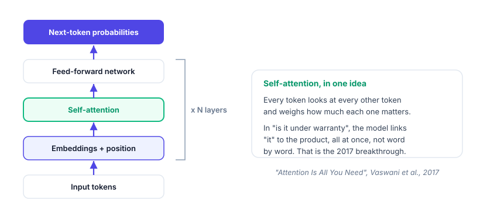
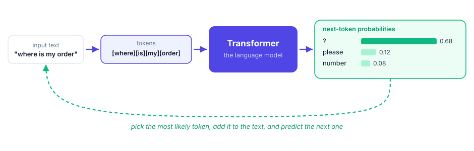

<!-- _class: lead -->
<!-- _paginate: false -->

AI for FDE &middot; Module 1 &middot; Session 2

# LLM Foundations for Solution Builders

### You have a GO. Now you build. Before you wire a language model into the Sunrise assistant, you need a real picture of what the model is, where it came from, what it costs, and how to choose one. And you need to know the tool you will build with.

No prior AI knowledge assumed. We start from the chat box you already know.

---

## Where you are starting

Be honest about the starting line, because it is a good one.

<h3>What you are</h3>
A strong software engineer. You ship code, read systems, and debug hard problems. That skill transfers directly.

<h3>What you are not (yet)</h3>
An AI specialist. You have used ChatGPT or Claude in a <strong>chat box</strong>. You have probably never called a model from code, and that is exactly what this module changes.

<b>The promise</b> By the end of Level 1 you will have built a working AI feature and be able to explain every part of it in an interview. Today is the on-ramp.

---

## From a chat box to a system

The chat window is one way to use a model. Building is another. Knowing the difference is the whole shift.

<h3>In the chat box</h3><ul><li>You are the user, typing to a model</li><li>One conversation, one window</li><li>The model answers from what it was trained on</li><li>No control over cost, format, or data</li></ul>

<h3>When you build</h3><ul><li>Your <strong>code</strong> calls the model through an API</li><li>You send it your data, your rules, your format</li><li>You wrap it with retrieval, guardrails, and checks</li><li>The model is one <strong>component</strong>, not the whole app</li></ul>

<b>The mental model</b> A language model is a function you call: text in, text out. Everything interesting is what you put around it.

---

## Today

Where AI came from&rarr;
What a model is&rarr;
Choose one on evidence&rarr;
Meet your coding agent&rarr;
Build the model layer

<h3>Foundations</h3>
Transformers and how we got here, what a model is, tokens, context, temperature, embeddings, model families, cost, and where it runs. Enough to build, and enough to answer for it in an interview.

<h3>Hands-on</h3>
Runnable demos you can explore, then the first layer of the Sunrise assistant: a pluggable model interface and a harness that picks a model on evidence.

---

<!-- _class: divider -->

Part 1

## How we got here, and what a model is

We start with the family tree, because the modern model is one branch of it, and interviewers ask.

---

## First, the family: neural networks

A language model is a kind of neural network. Neural networks have been evolving for decades; the model you call today is the latest branch.

<h3>What a neural network is</h3>
Layers of simple units ("neurons") with numbers ("weights") between them. You show it examples, it adjusts the weights, and it learns to map inputs to outputs. That is all "training" means.

<h3>Why it matters here</h3>
Everything that follows, tokens, attention, transformers, is a way to make this idea work well on <strong>language</strong>. Knowing the lineage makes the jargon stop being magic.

<b>Interview</b> "What is a neural network?" Layers of weighted connections trained on examples to map inputs to outputs. A large language model is a very large one, specialised for text.

---

## The evolution, in four steps

Perceptron&rarr;
Deep nets (MLP)&rarr;
RNN / LSTM&rarr;
Transformer

<h3>The first three</h3><ul><li><strong>Perceptron (1958):</strong> a single neuron. Learns simple splits.</li><li><strong>Deep nets:</strong> many layers. Learn rich patterns, but treat inputs as an unordered bag.</li><li><strong>RNN / LSTM:</strong> read a sequence word by word, and carry a memory. Good for language, but slow, and they <em>forget</em> over long text.</li></ul>

<h3>The breakthrough</h3>
The <strong>Transformer (2017)</strong> dropped the word-by-word reading. It looks at the whole sequence at once and learns what to pay attention to. Faster to train, and it remembers across long text.

<b>Interview</b> "Why did transformers replace RNNs?" RNNs read sequentially and lose long-range context; transformers process the whole sequence in parallel and capture long-range relationships with attention.

---

## "Attention Is All You Need" (2017)

One paper, from Vaswani and colleagues, is the root of every modern LLM. The idea it introduced is <strong>self-attention</strong>.

<b>Interview</b> "What is self-attention?" A mechanism that lets each token weigh how much every other token matters, so the model captures context (which word "it" refers to) across the whole input at once.

---

## Encoder, decoder, and the transformer

The original 2017 transformer had two halves. Which half a model keeps decides what it is good at, and it is why a chat LLM is what it is.

<h3>Encoder</h3>
Reads the whole input and builds a rich understanding of it. Good for classification, search, and <strong>embeddings</strong>. It does not generate text. <em>BERT.</em>

<h3>Decoder</h3>
Generates text one token at a time, using what it has produced so far. This is the <strong>chat LLM</strong>. <em>GPT, Llama, Claude, Gemini.</em>

<h3>Encoder plus decoder</h3>
Reads with an encoder, then writes with a decoder. Good for translation and summarization. <em>T5.</em>

<b>Interview</b> "Encoder-only, decoder-only, or encoder-decoder?" The 2017 transformer had both halves. A language model like GPT is <strong>decoder-only</strong>: it just predicts the next token. BERT is encoder-only (understands, does not generate). T5 keeps both.

---

## What a language model actually is

Strip away the magic and this is the whole engine: it predicts the next token, over and over.

<b>Interview</b> "How does an LLM work, in one sentence?" It turns text into tokens and repeatedly predicts the most likely next token. Fluency is not truth, which is why grounding (Session 4) matters.

---

## Tokens

The model does not read words or characters. It reads tokens.

<h3>What a token is</h3>
A chunk of text, often a word or part of a word. A rough rule: one token is about four characters, or three quarters of a word.

<h3>Why you care</h3>
Everything is counted and priced in tokens: the text you send (input) and the text it generates (output). Longer prompts and answers cost more and take longer.

<b>Interview</b> "What is a token?" The unit a model reads and bills in, roughly three quarters of a word. Cost and speed scale with token count, input plus output.

---

## The context window

The model has no memory between calls. Its only memory is what you send in this call.

<h3>The idea</h3>
The <strong>context window</strong> is the maximum number of tokens the model can consider at once: your instructions, your data, the conversation so far, and the answer it is writing. All of it must fit.

<h3>Why it shapes design</h3>
You cannot paste an entire company handbook into every call. You retrieve only the relevant pieces and send those. That is the whole reason RAG exists (Session 4).

<b>Interview</b> "What is the context window?" The model's working memory for one call, in tokens. It is finite, so you feed the model only what it needs, not everything.

---

## Temperature and determinism

The same prompt can give different answers. There is a knob for that.

<h3>Temperature</h3>
A setting from 0 upward that controls randomness in the output.

<h3>Low (near 0)</h3>
Focused, consistent, repeatable. What you want for grounded, factual answers.

<h3>Higher</h3>
More varied and creative, less predictable. Good for brainstorming, risky for support answers.

<b>Interview</b> "Why might a model give two different answers to the same prompt?" Sampling, controlled by temperature. Set it low when you need reliable, testable output.

---

## Generation versus embeddings

Models do two different jobs, and the Sunrise assistant needs both.

<h3>Generation</h3>
Text in, new text out. This is what writes the answer to a customer's question.

<h3>Embeddings</h3>
Text in, a list of numbers (a <strong>vector</strong>) out. Similar meanings give similar vectors, so you can search by meaning. This is how we find the right help article (Session 4).

<b>Interview</b> "What is an embedding?" A numeric vector that captures a text's meaning, so similar texts sit close together. It powers semantic search and retrieval, not text generation.

---

## Cost intuition and model tiers

You are spending real money per call. A builder keeps a rough meter running.

<h3>How it is priced</h3>
Per token, usually a small amount per thousand tokens, and often output costs more than input. Context is not free: a long prompt on every call adds up fast at 4,000 tickets a week.

<h3>Tiers</h3>
Providers offer small, medium, and large models. Bigger is more capable, more expensive, and slower. Much of the craft is using the <strong>smallest model that is good enough</strong>.

<b>Interview</b> "How do you control LLM cost?" Fewer tokens (shorter prompts, retrieve only what is needed), a smaller model where it suffices, and caching repeated work.

---

## Model families you will hear about

Not all models are the same shape. This is a map, not a deep dive; we treat the ones that matter in later sessions.

| Family / type | The idea, in one line | Frontier (closed) | Open weights |
| --- | --- | --- | --- |
| **Decoder-only transformer** | The classic chat LLM: reads text, generates the next tokens | GPT, Claude, Gemini | Llama, Mistral, Qwen |
| **Mixture of Experts (MoE)** | Many expert sub-networks; only a few fire per token, so it is big but efficient | several frontier models | Mixtral, DeepSeek |
| **Encoder-only** | Reads and understands text (does not generate); good for embeddings | mostly open | BERT, RoBERTa |
| **Encoder-decoder** | Reads, then writes: translation, summarization | mostly open | T5, FLAN-T5 |
| **Multimodal** | Text plus images and audio | GPT-4o, Gemini, Claude | Llama Vision, Qwen-VL |
| **Reasoning models** | Trained to think step by step before answering | o-series, Gemini, Claude | DeepSeek-R1, QwQ |
| **Small / efficient** | Tiny and fast, for on-device or low cost | Gemini Flash, Claude Haiku | Phi, Gemma |

<b>Interview</b> "What is a Mixture of Experts model?" A model split into many expert sub-networks where a router activates only a few per token, giving the capacity of a huge model at a fraction of the compute per call.

---

## Open weights vs closed weights

A model's weights are the trained numbers inside it. Whether you can have them decides what you can do.

<h3>Closed (proprietary)</h3>
The weights stay with the provider; you call the model over an API. <em>GPT, Claude, Gemini.</em>
<ul><li>Often the most capable, and the fastest to start</li><li>No infrastructure to run</li><li>Your data leaves your walls; you cannot host it yourself</li></ul>

<h3>Open weights</h3>
The weights are published; you download and run them yourself. <em>Llama, Mistral, Qwen, Gemma, DeepSeek.</em>
<ul><li>Run on-prem and keep data in region</li><li>Control, privacy, no per-token vendor fee</li><li>You run and maintain the infrastructure</li></ul>

<b>Interview and Sunrise</b> "Open or closed?" Closed is often more capable and simpler to start; open weights let you run on-prem and keep data in Bharat, which is what Sunrise's residency rule pushes you toward. Note: "open weights" is not the same as "open source", the license and training data may still be restricted.

---

## Where the model runs

Same model idea, three very different places to run it, and it matters for Sunrise.

<h3>Hosted API</h3>
Call a provider's model over the internet. Fastest to start, no infrastructure, but your data leaves your walls.

<h3>Open-weights, self-hosted</h3>
Run an open model on your own servers. More control and privacy, more work to operate.

<h3>On-prem</h3>
Self-hosted inside the customer's own environment. The answer when data cannot leave.

<b>Interview and Sunrise</b> Sunrise customer data must stay in <strong>Bharat</strong>. That residency rule can rule out a foreign hosted API and push you to an open model hosted in region. Always ask "where does the data go?"

---

## Part 1 recap: your interview checklist

<h3>You can now explain</h3><ul><li>Neural networks, and the path to transformers</li><li>Self-attention and why it replaced RNNs</li><li>Next-token prediction, and why fluent is not correct</li><li>Tokens, and how cost and speed scale with them</li></ul>

<h3>and</h3><ul><li>The context window, and why it forces retrieval</li><li>Temperature and determinism</li><li>Generation versus embeddings</li><li>Model families (including MoE), open versus closed weights, tiers, and where a model runs</li></ul>

<b>The bar</b> If you can say each of these in one plain sentence, you can hold your own in an AI-engineering screen. That is the minimum this session guarantees.

---

<!-- _class: divider -->

Part 2

## Choose a model on evidence, not hype

---

## Do not pick by vibes

"Everyone uses model X" is not a reason. Models differ, and the job decides.

capability
cost per token
latency
context size
hosting and residency
safety

<b>The point</b> A cheaper, smaller, in-region model that answers Sunrise's support questions well beats a famous model that is expensive, slow, or not allowed to hold the data.

---

## The model-comparison matrix

The instrument: score the candidates on what the job needs, in one table.

| Factor | What to check |
| --- | --- |
| **Capability** | Does it answer the golden questions correctly and grounded? |
| **Cost** | Price per 1,000 tokens, at the real volume (thousands of tickets a week) |
| **Latency** | Time to answer; will a customer wait for it? |
| **Context** | Big enough to hold the retrieved passages plus instructions? |
| **Hosting / residency** | Can it run where the data must stay (Bharat)? |
| **Safety** | Does it refuse and escalate cleanly when it should? |

<b>Evidence, not opinion</b> Fill this from a real run, not from a blog post.

---

## Model benchmarks: where to look

For the capability row, do not trust marketing. Public benchmarks give a first read, and a few sites make the comparison easy.

<h3>Leaderboards and comparison sites</h3><ul><li><strong>LMArena</strong> (Chatbot Arena): human-preference ranking across models</li><li><strong>Artificial Analysis</strong>: quality, speed, and price side by side</li><li><strong>Hugging Face Open LLM Leaderboard</strong>: standard benchmarks for open models</li><li><strong>HELM</strong> (Stanford): a holistic, multi-metric evaluation</li></ul>

<h3>Benchmarks you will see quoted</h3><ul><li><strong>MMLU</strong>: broad knowledge across subjects</li><li><strong>GPQA</strong>: hard, graduate-level reasoning</li><li><strong>HumanEval</strong> and <strong>SWE-bench Verified</strong>: coding</li><li><strong>GSM8K</strong>: grade-school math word problems</li></ul>

<b>Interview</b> "How do you compare model capability?" Start with a leaderboard (LMArena, Artificial Analysis) and the benchmarks that match your task (MMLU, GPQA, SWE-bench). Then confirm on your own golden set: public benchmarks can be leaked or gamed, and none of them is your support queue.

---

## Eval-driven selection

The honest way to choose: let a small test decide.

Golden set&rarr;
Run one task 3 ways&rarr;
Score each&rarr;
Recommend, with reasons

<h3>The golden set</h3>
A handful of real support questions with known good answers. The same set you reuse to test grounding and the whole PoC.

<h3>The output</h3>
A recommendation you can defend: "model B, because it matched on the golden set, costs half as much, and runs in region."

---

## Sunrise: what the model has to be

<h3>Must</h3><ul><li>Answer order, return, and simple-warranty questions from provided text</li><li>Cheap enough at thousands of tickets a week</li><li>Low latency (a customer is waiting)</li></ul>

<h3>Constraint</h3><ul><li>Runs where data stays in Bharat</li><li>Escalates cleanly when unsure (warranty is sensitive)</li></ul>

<b>Where this lands</b> This is exactly the model-comparison harness you build today. It turns "which model?" into a scored answer.

---

<!-- _class: divider -->

Part 3

## How you will actually build: coding agents

---

## You will not hand-write all of this

Modern AI features are built with an AI helper in the loop. This is a skill in itself.

<h3>A chat assistant</h3>
Answers questions in a window. You copy and paste code back and forth. You did this with ChatGPT.

<h3>A coding agent</h3>
Works <strong>inside your project</strong>: it reads your files, writes and edits code across them, runs commands and tests, sees the errors, and fixes them. It acts, it does not just chat.

<b>Why it matters for an FDE</b> You will stand up a working PoC in hours, not weeks. The agent does the typing; you provide the judgment, the review, and the direction.

---

## The landscape

Coding agents come in three shapes. Knowing the shapes helps you choose.

<h3>Terminal / CLI</h3>
Live in your command line. Strong at multi-file work and running things. <em>Claude Code, Aider, Gemini CLI, Codex CLI.</em>

<h3>IDE-integrated</h3>
Live in your editor. Smooth for editing as you go. <em>Cursor, Copilot, Windsurf, Cline, Antigravity.</em>

<h3>Autonomous / cloud</h3>
Take a task and work on their own, async. <em>Devin, Copilot Workspace, Jules.</em>

<b>Not a ranking</b> These overlap and change monthly. What matters is fit for the job and how much control you keep.

---

## Coding agents, compared

| Tool | Type | Free tier | Strengths | Watch-outs |
| --- | --- | --- | --- | --- |
| **Claude Code** | Terminal + IDE | Paid plans | Strong multi-file reasoning, runs and tests, top on coding benchmarks | Usage cost; review diffs |
| **Cursor** | IDE (fork) | Yes, limited | Smooth inline + agent, multi-model | Pro subscription |
| **GitHub Copilot** | IDE plugin | Yes | Everywhere, cheap, familiar | Agent mode younger |
| **Windsurf** | IDE | Yes, generous | Agentic flows | Younger ecosystem |
| **Google Antigravity** | Agentic IDE | Yes, free preview | Agent-first across editor, terminal, browser; Gemini 3 | Very new |
| **Cline** | VS Code ext (open) | Free, bring your model | Transparent, model-agnostic | You pay model API |
| **Aider** | Terminal (open) | Free, bring your model | Git-aware, scriptable | Terminal only |
| **Gemini CLI** | Terminal | Yes, generous | Free agentic CLI | Newer |
| **Devin / Jules** | Autonomous | Limited / paid | Hands-off scoped tasks | Less control, cost |

---

## Cost and benchmarks, for the course

Two practical questions: what does it cost a trainee, and how do you compare their strength honestly?

<h3>Free tier, for training</h3>
You can complete this course at no tool cost. <strong>Gemini CLI</strong>, <strong>Antigravity</strong> (free preview), <strong>Windsurf</strong>, and <strong>Copilot</strong> have real free tiers; <strong>Cline</strong> and <strong>Aider</strong> are free tools where you pay only for a cheap model's API. Paid agents (Claude Code, Devin) bill by usage or subscription.

<h3>How to compare strength</h3>
Do not trust marketing. The standard benchmark is <strong>SWE-bench Verified</strong> (can the agent fix real GitHub issues); <strong>Terminal-Bench</strong> tests terminal tasks. Check the current leaderboard when you choose; the order shifts monthly.

<b>Rule of thumb</b> Frontier agents (Claude-based and Gemini-3-based) lead the coding benchmarks today. For learning, a strong free tier that you can review beats the last few benchmark points.

---

## How to pick

<h3>Weigh these</h3><ul><li><strong>Task fit:</strong> multi-file build vs quick edits</li><li><strong>Model quality:</strong> the brain behind the agent (check SWE-bench)</li><li><strong>Control:</strong> can you see and approve every change?</li></ul>

<h3>and these</h3><ul><li><strong>Cost and free tier:</strong> what will you actually pay?</li><li><strong>Privacy:</strong> can it run against a private or on-prem setup?</li><li><strong>Your comfort:</strong> terminal or editor</li></ul>

<b>The rule</b> Pick one you can <strong>review and steer</strong>. An agent you cannot check is a liability, not a speed-up.

---

## Our recommendation for this course

<h3>Use in the walkthroughs</h3>
We use <strong>Claude Code</strong>: it handles multi-file Python builds, runs the eval harness, keeps repo-wide context, and leads the coding benchmarks. If you want a free path, <strong>Gemini CLI</strong> or <strong>Antigravity</strong> (free preview) will build this PoC too.

<h3>Also strong</h3>
<strong>Cursor</strong> for an editor-first experience; <strong>Aider</strong> or <strong>Cline</strong> for a fully open, model-agnostic setup where you control cost.

<b>Pick one, learn it deeply</b> Any of these will build the PoC. The win is fluency with one tool, not owning ten.

---

## Working with an agent well

The agent is fast and confident. Your job is to keep it honest.

<h3>Do</h3><ul><li>Give it context: the goal, the files, the constraints</li><li>Work in small steps you can check</li><li>Read every diff before you accept it</li><li>Keep tests; let them catch the agent</li></ul>

<h3>Do not</h3><ul><li>Accept large changes you have not read</li><li>Let it invent APIs or secrets</li><li>Skip running the code because "it looks right"</li></ul>

<b>Coming up</b> Across the phase you will learn to drive the agent well: give it <strong>memory</strong> (today), then efficient context, reusable <strong>skills</strong>, an eval <strong>harness</strong>, and a build-run-check <strong>loop</strong>.

---

<!-- _class: divider -->

Part 4

## What we build today: the model layer

---

## The PoC, and today's layer

Recall the target from the GO memo: the Sunrise Support Deflection Assistant. We build it one layer per session.

Model layer&rarr;
Prompt + output&rarr;
Grounding (RAG)&rarr;
Assemble + demo

<b>Today</b> The model layer: a clean, pluggable way to call a model, and a harness to choose one. Everything later plugs into this.

---

## The model interface

One small contract, so the rest of the PoC never cares which model is behind it.

<h3>Two jobs</h3>
<code>generate(prompt)</code> returns text. <code>embed(texts)</code> returns vectors. That is all the rest of the code needs to know.

<h3>Pluggable</h3>
A <strong>deterministic mock</strong> runs offline with no keys, so everything is testable. A real or on-prem adapter plugs in behind the same interface, chosen by an environment variable. Secrets never live in the code.

<b>Why offline first</b> Every build in this course runs with no API key, so you are never blocked. Add a real model when you want, without changing a line of the caller.

---

## Explore the concepts: the demos

Five short, offline demos back the foundations. Each is documented in <code>demos/cookbook.md</code> with what to run and what to watch for.

<h3>The demos</h3><ul><li><code>predict.py</code> the model guessing the next token</li><li><code>tokens.py</code> tokens and cost</li><li><code>temperature.py</code> randomness and determinism</li><li><code>embed_vs_generate.py</code> the two model jobs</li><li><code>mock_model.py</code> the offline model behind the interface</li></ul>

<h3>How to use them</h3>
Follow <code>demos/cookbook.md</code>. Do not just read the output: change the input, predict what will happen, run it, and see if you were right. That is how the concept sticks.

<b>Where they live</b> Runnable in the <code>demos/</code> project, no API key needed. The cookbook is the detailed try-it guide.

---

## The live lab today

<h3>You will build (with your coding agent)</h3><ul><li>The help corpus and golden question set (used all phase)</li><li>The model interface, with the offline mock</li><li>A real/on-prem adapter behind the same interface</li><li>The model-comparison harness with a recommendation</li></ul>

<h3>Agent skill today: memory</h3>
You will give your coding agent a <strong>memory</strong> file: the repo conventions, the PoC contract, and the goal, so it builds to spec instead of guessing. This is the first coding-agent skill of the phase.

<b>The deliverable</b> A model-comparison harness: one task, three ways, one defended pick.

---

## Recap, and what you can now do

<h3>You learned</h3><ul><li>How AI got here: neural nets to transformers to self-attention</li><li>What a model is, and its foundations, at interview depth</li><li>Model families, and how to choose one on evidence</li><li>What a coding agent is, how to pick one, and how to give it memory</li></ul>

<h3>You built</h3><ul><li>The corpus and golden set</li><li>A pluggable model layer</li><li>A comparison harness with a recommendation</li></ul>

<b>Next</b> Session 3, Prompt Engineering and Structured Outputs: make the model return reliable, structured, guardrailed answers you can trust in code.

---

<!-- _class: lead -->

Session 2 &middot; Complete

# You understand the tool, and you have the first layer.

From neural networks to transformers to a running model layer. You can choose a model on evidence, build with a coding agent, and you have laid the first layer of the Sunrise assistant.

### Next: Session 3, make it reliable. Structured, valid, guardrailed output the rest of the PoC can trust.
